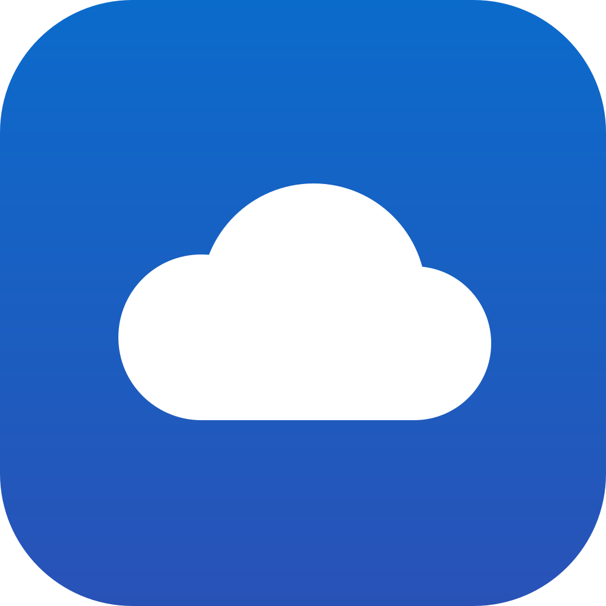

<p align="center">
  
</p>

<h1 align="center">FileCloud</h1>

Your own cloud for files, sharing, calendars and contacts. You run it yourself: **one container** (server and
database inside), a browser app, and a native Android app that updates over the air.

## Features

- **Files:** drag-and-drop upload (whole folders too), resumable uploads, previews for images, video, audio and
  PDF, a text editor, versions, trash, favorites, recent files, search, and download a folder as ZIP.
- **Sharing:**
  - with users or groups, read-only or editable;
  - public links with a password, an expiry date, and optional upload into the shared folder.
- **Calendar and contacts:** web apps, plus CalDAV/CardDAV sync with Thunderbird, DAVx⁵, Apple
  Calendar/Contacts and others.
- **WebDAV:** mount your files in Finder, Windows Explorer, rclone or Cyberduck.
- **Android app:**
  - browse files, preview them and share links;
  - keep files available offline;
  - back up photos automatically;
  - calendar and contacts;
  - **over-the-air updates** delivered by your own server.
- **Administration:** users, groups, quotas, app passwords, and publishing Android releases.

## Quick start

You only need two files on your server, in one folder: [`docker-compose.yml`](docker-compose.yml) and your
`.env`.

```sh
cp .env.example .env          # set ADMIN_PASSWORD (everything else is optional)
docker compose up -d          # pulls ghcr.io/fahed-alhammadi/filecloud:latest
```

Or without compose:

```sh
docker run -d --name filecloud --restart unless-stopped --env-file .env -p 8080:8080 \
  -v filecloud-data:/data -v filecloud-db:/var/lib/filecloud/db \
  ghcr.io/fahed-alhammadi/filecloud:latest
```

The image contains FileCloud and its own PostgreSQL 17. The database is reachable only inside the container
(no network port, no password to manage). Point `DATABASE_URL` at an external PostgreSQL if you prefer.

Open http://localhost:8080 and sign in as `ADMIN_USER` / `ADMIN_PASSWORD`. If `ADMIN_PASSWORD` is empty, a
random one is printed in `docker compose logs filecloud`.

**Build from source instead** (development or your own changes), from the repository root:

```sh
docker compose -f deploy/docker-compose.yml --env-file .env up -d --build
```

Both compose files use the same project name and volumes, so switching between them keeps your data.

## Production

FileCloud serves plain HTTP on `APP_PORT` (default 8080). Put it behind your reverse proxy for TLS, and set
`TRUST_PROXY=true` in `.env`. The proxy must:
- forward `Host`, `X-Forwarded-For` and `X-Forwarded-Proto`;
- allow unlimited request bodies and long timeouts (uploads arrive in 8 MB chunks; downloads stream);
- pass all HTTP methods through (WebDAV uses PROPFIND, MKCOL, MOVE, COPY, LOCK, REPORT…).

Set `APP_BIND=127.0.0.1` if the proxy runs on the same host.

Example nginx location:

```nginx
location / {
    proxy_pass http://127.0.0.1:8080;
    proxy_set_header Host $host;
    proxy_set_header X-Forwarded-For $proxy_add_x_forwarded_for;
    proxy_set_header X-Forwarded-Proto $scheme;
    client_max_body_size 0;
    proxy_request_buffering off;
    proxy_buffering off;
    proxy_read_timeout 3600s;
}
```

**Back up** the database (`DB_PATH`) and the user files (`DATA_PATH`) together. For a consistent database dump
while FileCloud runs:

```sh
docker exec filecloud su-exec node pg_dump -h /run/filecloud -U filecloud filecloud > filecloud.sql
```

(Use your `APP_USER` uid instead of `node` if you changed it.)

### Storing files on NFS or another disk

User files live wherever `DATA_PATH` points. That folder holds uploads in progress, versions and trash
too, so everything moves together. To use an NFS share:

1. Mount the share on the host, e.g. `/mnt/filecloud` (add it to `/etc/fstab` so it mounts before Docker
   starts).
2. Make it writable by the user FileCloud runs as: `sudo chown 1000:1000 /mnt/filecloud`, or match the NFS
   export's owner with `APP_USER`.
3. In `.env`, set `DATA_PATH=/mnt/filecloud`, and `APP_USER=1000:1000` if it differs. Keep `DB_PATH` (the
   database) on a local disk; databases on NFS risk corruption.
4. Run `docker compose up -d`.

If the folder isn't writable, the app refuses to start and logs exactly which uid:gid needs access.
Moving an existing install: stop the stack, copy the contents of the old storage (for the default volume:
`docker run --rm -v filecloud_app-data:/from -v /mnt/filecloud:/to alpine cp -a /from/. /to/`), set
`DATA_PATH`, and start again.

## Updates

**Server.** The root `docker-compose.yml` runs `ghcr.io/fahed-alhammadi/filecloud:latest`. To update to the
newest release:

```sh
docker compose pull && docker compose up -d
```

The database schema migrates itself at startup. Your data stays in the volumes. The release workflow in
`.github/workflows/release.yml` publishes the image to GitHub Container Registry when you push a `v*` tag.

**Android app.** Publish a new APK and every installed app offers the update:

```sh
mobile/android/build-apk.sh              # bump versionCode/versionName in app/build.gradle.kts first
FILECLOUD_URL=https://cloud.example.com FILECLOUD_TOKEN=<admin app password> \
  mobile/android/publish-apk.sh "What's new"
```

You can also upload it in *Administration → Android app*. Users download the first install from
`https://<your-server>/download/android`, which is also linked on the login page. See
[mobile/README.md](mobile/README.md) for details.

## Connecting other apps

Create an app password under *Settings → Connect apps and devices*, then use:

| Client | Address |
|---|---|
| WebDAV (Finder, Explorer, rclone, Cyberduck) | `https://<host>/dav/files/<username>/` |
| CalDAV / CardDAV (Thunderbird, DAVx⁵, Apple) | `https://<host>/dav/` (auto-discovered via `/.well-known/caldav` and `/.well-known/carddav`) |

## Configuration (`.env`)

| Variable | Default | Purpose |
|---|---|---|
| `ADMIN_USER` / `ADMIN_PASSWORD` | `admin` / random | First administrator (created on first start) |
| `APP_PORT` / `APP_BIND` | `8080` / `0.0.0.0` | Published port and interface |
| `APP_USER` | `1000:1000` | uid:gid the server runs as |
| `DATA_PATH` | `app-data` (volume) | Where user files are stored: a volume name or a host folder |
| `DB_PATH` | `db-data` (volume) | Where the built-in database is stored (local disk) |
| `DATABASE_URL` | built-in | External PostgreSQL instead of the built-in one |
| `TRUST_PROXY` | `false` | Honor `X-Forwarded-*` headers (only behind a proxy) |
| `TRASH_RETENTION_DAYS` | `30` | Days before trashed items are deleted |
| `MAX_VERSIONS` | `20` | Versions kept per file |

## Development

| Task | Command |
|---|---|
| Type-check the server | `cd app && npm install && npm run typecheck` |
| End-to-end tests (stack running) | `python3 tests/e2e.py http://localhost:8080 admin '<admin password>'` |
| Android debug build | `cd mobile/android && ./gradlew assembleDebug` (JDK 17+, Android SDK 35) |

See [docs/ARCHITECTURE.md](docs/ARCHITECTURE.md) for how FileCloud works inside.

## Project layout

```
app/                 server (Node.js/TypeScript) and the HTML5 web app (app/public)
mobile/android/      native Android app (Kotlin, Jetpack Compose)
docs/                architecture notes
deploy/              docker-compose.yml that builds the image from source
tests/               end-to-end API/WebDAV/CalDAV/CardDAV tests
.github/workflows/   CI and release automation (Docker image + APK)
```
